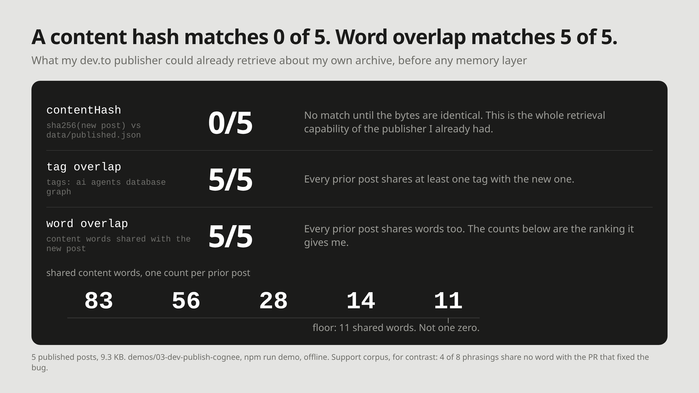

> I write for Cognee. Measured on 2026-10-19: Node v26.8.2, npm 11.19.1, `@cognee/cognee-ts` 0.2.0, vitest 2.1.9, Linux. The demo is linked at the end.

```text
one new post, 5 published posts, one run

contentHash (sha256)   0/5 matched
content-word overlap   5/5 matched, lowest 11 shared words
```

The first row is an equality check doing what it is for. The second row is what happens when I put a different question to the same archive: have I written about this before. Five of five, with a floor of 11 shared words, is not an answer to that.

## The tool already reasons about exact matches

`dev-publish` is a small publisher I wrote: hand-written Markdown in, dev.to articles out. It is deliberately non-AI. It reads the frontmatter, takes the sha256 of the raw file as `contentHash` (`src/frontmatter.ts:29`), compares that against `data/published.json`, and decides create, update or skip. No model, no key, no index.

The demo in this repo runs it over a fixed corpus: 5 published posts, 9.3 KB of body text, and 1 post being published. Two questions look like one question when you are the author:

- Did this file change?
- Have I covered this ground before?

The hash answers the first one perfectly. I wanted to know how close it came to the second one before I added anything to the program, so I measured that first.

## What I measured before adding anything

Three rows, all from `npm run demo` in `demos/03-dev-publish-cognee`, offline, no key. The counts are computed at run time, not stored:

```text
corpus: 5 published posts (9.3 KB), 1 being published
new post: fixtures/blogs/post-just-use-a-database-is-half-right.md

contentHash   0/5
  sha256 of a different file matches nothing. this is the entire retrieval
  capability of data/published.json.

tag overlap   5/5   [ai agents database graph]

word overlap  5/5
  (0/5 prior posts share no content word with this one)
  56 fixtures/blogs/01-grep-as-agent-memory.md
  83 fixtures/blogs/02-just-use-a-database.md
  28 fixtures/blogs/m1-agent-writes-back-not-rag.md
  14 fixtures/blogs/m6-300-tokens-beat-113k.md
  11 fixtures/blogs/m7-benchmarks-vs-production.md
```

Row 1 is 0 of 5 by construction: sha256 is an equality check, and two different files are not equal.

Row 2 is 5 of 5 on the tags `[ai agents database graph]`. Row 3 is 5 of 5 on content words, with the per-post counts above and the floor at 11. The tokenizer in row 3 is this repo's own: lowercase, `[a-z]+`, the same stop-word set, length over 2, ported byte for byte from `experiments/db_memory/db_demo.py`. Row 3 and the word-overlap count I ran on the support corpus for the previous article used the same method, not just the same name.



## The same failure, upside down

The support corpus in [the database article](02-just-use-a-database.md) failed the other way. Customers described one billing bug in 8 phrasings. Four of the 8 share no content word with PR #4812, which fixed it. One shares only "invoice", a word that appears in 80.5% of all sessions and therefore connects to almost everything. Word matching missed.

Here, on one author's archive, word matching misses nothing. Every prior post shares a tag, and every prior post shares between 11 and 83 content words with the new one. Row 3's printed line says it directly: 0 of 5 prior posts share no content word with this one.

Both rows are the same mechanism failing. On a corpus where the writers are different people, overlap is near zero and the signal vanishes. On a corpus where the writer is one person writing about one subject, overlap is everywhere and the signal vanishes again. A ranking whose floor is 11 is not a ranking. It tells me that every post I have written covered this ground, which I already knew, and it does not tell me which one.

## The question I actually need answered

What I want in the terminal after a publish is not "prior coverage exists". It is which post, which claim, and at what URL, so I can paste a link into the new piece. That is a retrieval question about entities — a post, a claim, a measurement, a URL — not about words.

Cognee documents a mechanism for it. `GRAPH_COMPLETION` embeds the query once, then searches "concurrently across every vector index collection registered by the loaded DataPoint models — typically `Entity_name`, `EntityType_name`, `TextSummary_text`, `DocumentChunk_text` — plus the edge collection `EdgeType_relationship_name`", and expands 1 hop around those seeds ([Cognee's search docs](https://docs.cognee.ai/core-concepts/main-operations/legacy-operations/search)). The claim in that mechanism is that two differently-worded posts connect through a shared entity or relationship phrase instead of a shared word. It depends on the extraction having pulled the same entity out of both, and it can fail.

Rows 4 and 5 of the demo's scoreboard would say whether it does. They have not been run here: there was no OpenAI-compatible key on this machine.

## Where it drops in

The integration is one method, `CogneeMemory.relate` in `src/memory.ts`: `recall()` first, then `remember()`, in that order, so a post can never be its own top hit (`src/memory.ts:76`, recall at `:99`, remember at `:116`).

The seam is the last statement of `main()`'s per-file success path in dev-publish, downstream of `saveState`. That placement is the whole safety argument. It is the only point where the published URL, the article ID, the final body and the verb all exist and are known-good. It is after the state write, so a memory failure cannot corrupt `data/published.json`. The call site swallows its own error and logs instead of pushing to `failures`, so a memory outage does not turn a green publish red. The `skip` branch returns early, so unchanged posts are never re-ingested: the existing `contentHash` drives ingestion for free. The dev-publish side of the change is vendored as `seam.patch` against `8b42526` and is not applied to anything.

One thing the recall is not: dataset-scoped. In `@cognee/cognee-ts` 0.2.0 the `datasets` filter on `recall()` is unusable, because it needs a `user_id` that the recall options type has no field for, and the call is rejected before any network call. So the call is `sdk.recall(query, { topK: 5 })`, unfiltered, and the only reason that is safe here is that `remember()` is the only writer and only ever writes one dataset.

## What it cost, and what it does not pay back

`npm install` leaves `node_modules/` at 372 MB on this machine, measured with `du -sh`. Almost all of it is one prebuilt native addon: `@cognee/neon-linux-x64-gnu` reports `dist.unpackedSize` of 323,421,814 bytes in `npm view`.

Against that, Cognee's own published break-even for graph ingestion is "roughly 23–26 repeated queries against the same corpus" ([Cognee on AI memory tools vs databases](https://www.cognee.ai/ai-memory-tools-vs-databases)). A blog with six posts, publishing a few times a month, never reaches it. This demo shows no saving and claims none. What the ingestion buys is a different question being answerable at all. That is a capability, not a saving.

## What I did not measure

- **The Cognee rows never ran.** No key, so the demo printed `cognee rows: skipped (set COGNEE_LLM_API_KEY to run them)`. Nothing here claims anything about what `recall()` returned, what it ranked first, or how long it took.
- **The archive is 5 posts.** Overlap counts on 5 documents by one author are not a result about archives in general. They are a result about this one, and it is the archive the feature would actually run against.
- **The dev.to URLs are placeholders** on `dev.to/example/...`, because nothing in this repo is published yet. The sha256 digests in `fixtures/published.json` are real digests of the fixture files, so row 1 is a real computation.
- **The score is printed and never used to decide.** `CogneeRecallItem.score` is a required number whose scale and direction are undocumented, so any threshold would be invented.
- **The seam has no test.** What was checked is that it compiles and breaks nothing: `tsc --noEmit` clean and dev-publish's own `vitest run` green with the patch applied. That says nothing about its behaviour against a real key.

## Run it yourself

The demo is in [yashksaini-coder/cognee-agent-memory-experiments](https://github.com/yashksaini-coder/cognee-agent-memory-experiments):

```bash
cd demos/03-dev-publish-cognee
npm install                               # dev deps + cognee: 372 MB, almost all addon
npm test                                  # 5 assertions, no key, no network
npm run demo                              # rows 1-3 offline
COGNEE_LLM_API_KEY=sk-... npm run demo    # rows 4 and 5, which I could not run
```
