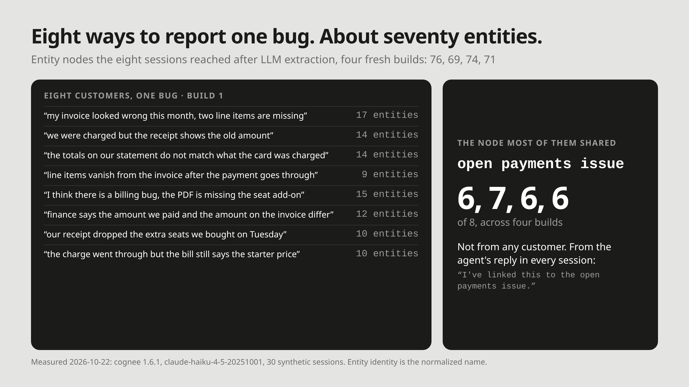

> I write for Cognee. Tested on 2026-10-22: cognee 1.6.1, claude-haiku-4-5-20251001 for extraction and answers, fastembed `BAAI/bge-small-en-v1.5` for embeddings, Python 3.12, Linux. Every number below is read from `entity-resolution-results.json`; scripts are linked at the end.

```text
eight phrasings of one bug, four fresh builds      Entity nodes they reached: 76, 69, 74, 71
the node that joined the most of them              "open payments issue": 6, 7, 6, 6 of 8
where that name came from                          the agent's reply, not the customers
```

Eight customers reported one billing bug, each in their own words. After LLM extraction the eight sessions touched about seventy different entities. The one entity most of them shared came from a sentence the support agent wrote, not from anything a customer said.



## The assumption worth testing

The usual expectation is that an LLM extractor will notice that "two line items are missing" and "our receipt dropped the extra seats" describe the same bug, and file both under one node. That is what makes a graph worth having: one node per real thing, with every mention attached to it.

Cognee's own docs describe what happens when that doesn't occur: when one real-world thing "is extracted under several names (`New York City` and `NYC`), it becomes several `Entity` nodes and its edges are split across all of them." So the question is how often it occurs on text written by different people, and what fixes it.

## The setup

The corpus is the one from the [grep](01-grep-as-agent-memory.md) and [database](02-just-use-a-database.md) articles: synthetic support sessions, generated with a fixed seed. In it, 0.5% of sessions report the same billing-sync bug in one of eight phrasings:

```text
"my invoice looked wrong this month, two line items are missing"
"the totals on our statement do not match what the card was charged"
"our receipt dropped the extra seats we bought on Tuesday"
... five more
```

Every bug session also contains the agent's reply: *"I've linked this to the open payments issue."* Remember that line; it decides the result.

`demos/02-cognee-graph/build_graph.py` takes 30 documents from the 10,000-session corpus — one bug session per phrasing, 20 ordinary sessions, a plan-change session and the note for the PR that fixed the bug — and runs `remember()` on them with an LLM doing extraction. It then reads the graph back and counts which Entity nodes each phrasing's session reached. I built it four times from an empty store.

## Extraction keeps the eight apart

| build | remember() | nodes / edges | entities the 8 reached | shared by 2+ |
|---|---|---|---|---|
| 1 | 147.8 s | 377 / 1,048 | 76 | 17 |
| 2 | 66.3 s | 367 / 1,045 | 69 | 16 |
| 3 | 74.6 s | 378 / 1,049 | 74 | 10 |
| 4 | 75.4 s | 363 / 1,010 | 71 | 14 |

The same 30 documents produce a different graph each time, because extraction is a model call. The pattern doesn't change: each phrasing reaches 9 to 17 entities of its own, and the customers' descriptions never land on a shared "this bug" node.

The reason is in how Cognee assigns identity. An Entity's id is a uuid5 of its normalized name, lowercased with spaces turned into underscores (`generate_node_id.py`). Two mentions become one node when, and only when, the extractor gives them the same name. "Two line items are missing" and "the receipt shows the old amount" get different names, so they get different nodes.

## The join came from the write path

What did join them was "open payments issue": 6, 7, 6 and 6 of the eight across the four builds. That phrase appears in exactly one place, the agent's reply. Identical text in every session gave the extractor an identical name to emit, and an identical name became one node. It still missed one or two sessions per build: an LLM emits the name most of the time, not every time.

That is the practical lesson, and it is cheaper than anything after it. The moment an agent writes back is the moment you control the vocabulary. If the agent names the thing it is talking about — a ticket id, an issue title, a canonical product name — every mention written that way joins one node for free. The customers will never agree on wording. Your agent can.

## Merging after the fact

For entities already split, Cognee ships an opt-in consolidation pass, `consolidate_entities`. It embeds every Entity name, clusters names whose cosine similarity clears a threshold (0.85 by default), and merges each cluster into one canonical node. Nothing calls it automatically; you run it on a finished graph. `demos/02-cognee-graph/consolidate.py` runs its detection step read-only at five thresholds and prints what would merge.

On build 1, with default settings:

| threshold | clusters | nodes removed | entities the 8 reached | a merge it proposed |
|---|---|---|---|---|
| 0.95 | 10 | 10 | 74 | `2026-01-10` = `2026-03-10` |
| 0.90 | 22 | 50 | 69 | `wayne-1210` = `wayne-1238` |
| 0.85 | 21 | 99 | 60 | five different `globex-*` customers |
| 0.80 | 25 | 118 | 55 | 60 different session ids in one node |

Every row merges identifiers. To an embedding model, `wayne-1210` and `wayne-1238` are nearly the same string; to your agent they are two customers whose invoices must never mix. Even at 0.95 it would have fused two dates two months apart.

The pass has a switch for this, `protect_node_types`, which keeps entities of the listed types out of every merge. With the seven identifier types the extractor used protected (`session`, `support session`, `customer`, `organization`, `date`, `email address`, `email` — it filed the same kind of thing under two names three times), the same sweep proposes merges that are right:

```text
0.85   "line items vanish from invoice after payment" = "missing invoice line items"
       "open payments issue" = "payment issue"
0.80   "billing bug" = "line items vanish from invoice after payment" = "missing invoice line items"
       = "open payments issue" = "payment invoice discrepancy" = "payment issue"
0.75   ... = "invoice currency conversion" = "invoice resend request" = "vat number on invoices"
```

0.80 was the best setting on build 1; at 0.75 the bug starts absorbing unrelated invoice requests.

Build 4 is the warning. The same protect list and the same 0.80 fused two different sessions, because this build's extractor filed them under a third spelling, `supportsession`, that the list didn't name. It also merged distinct billing features — "eur invoice", "invoice email address change", "vat number on invoices" — into one node, while splitting the bug into two pairs. A protect list written for one graph doesn't carry to the next build, and neither does a threshold. That is why the docs tell you to run it with `dry_run=True` first, every time.

## Running the merge for real

The docs also say to back up the graph and vector stores before running it for real. Take that literally. I applied the protected merge at 0.80 four times. Twice it worked: build 1 went from 377 nodes to 358, and "open payments issue" absorbed its duplicates to reach 7 of the 8 phrasings. Twice it stopped partway, while re-pointing edges, with an assertion inside the embedded graph store (`csr_node_group.cpp:434`), leaving the graph between states.

## What merging did not change

Merged nodes are a means. The end is an agent that can answer "which customers hit this bug?", so I asked Cognee's `recall()` exactly that and counted correct customer ids against the corpus truth. The PR note lists session ids but no customers, so the answer has to come from the sessions.

Before consolidation, across 23 asks on three builds, recall named 1.9 of the 8 customers on average, and never a wrong one. After a successful merge on build 2 it named 4, 5 and 5 — three asks, on the one build where the merge both ran and was measured, so I am not counting it as a result. A listing question needs every session's customer in the retrieved context, and a tidier graph alone did not get it there in these runs. That is a retrieval question, and the next article in this series.

## What to do with this

1. **Name things at write time.** The only join that survived every build came from the agent's own wording. Give your agent a canonical name for what it is talking about and use it every time it writes back.
2. **Protect identifiers before any merge, from the types this graph actually has.** Customer, session, account, date and email at minimum. Read the EntityType names off the graph first: across four builds mine used `session`, `support session` and `supportsession` for one thing.
3. **Pick the threshold per graph, with a dry run.** 0.80 was clean on build 1 and merged distinct features on build 4; 0.75 was wrong on both.
4. **Back up, then check the result.** Count nodes before and after; a merge that stopped partway is quiet about it.

## Limits

- Synthetic sessions, 30 documents, one extraction model. Real support text is messier; a capable model may also do better or worse than Haiku at naming.
- The agent sentence is identical in every session by construction. A real agent's replies vary, which is the argument for making them not vary.
- Recall was measured with one question and small samples, and the post-merge sample is too small to claim anything.
- Embeddings are a 384-dimension local model; a larger embedding model would move the thresholds.

## Run it yourself

The scripts are in [yashksaini-coder/cognee-memory-experiments](https://github.com/yashksaini-coder/cognee-memory-experiments):

```bash
python3 experiments/grep_memory/make_corpus.py corpus/10000 10000         # the sessions, seeded
cd demos/02-cognee-graph
python build_graph.py ../../corpus/10000 --prune                        # extract, count, graph.html
python consolidate.py ../../corpus/10000 --protect session,customer,date # dry-run sweep
python consolidate.py ../../corpus/10000 --ask --runs 10                 # score recall
```

Cognee's [entity deduplication guide](https://docs.cognee.ai/guides/memify-entity-deduplication) documents the consolidation pass and its options.
