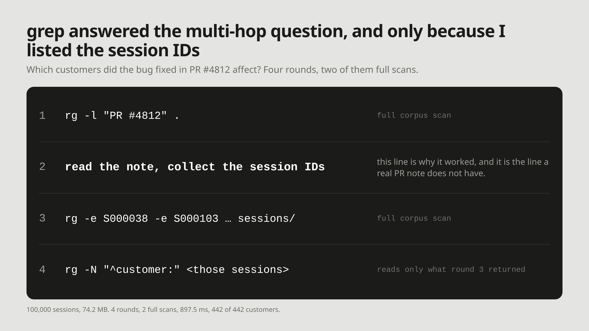

# M11: grep answered the multi-hop question, and only because I listed the session IDs myself

**For:** Cognee's LinkedIn and X. **LinkedIn length:** 146 words. **X length:** 193 characters.

## LinkedIn

"Which customers did PR #4812's bug affect?", over 100,000 synthetic support sessions: 4 rounds, 2 full corpus scans, 897.5 ms, 442 of 442 affected customers, about 8,701 estimated tokens read.

It worked because I generated the corpus. The note's title is realistic — "fix payment sync delay dropping line items". Its last line is not: "Reported in sessions: ", then every session ID that reported the bug. A real PR note names a module and a symptom, and no sessions. Delete that line and round 3 has nothing to search for.

The round count is structural: the same 4 rounds and 2 scans at 1,000, 10,000 and 100,000 sessions. Hops belong to the question, not the corpus.

"Which functions call process_payment?" is the same two hops with no ID list underneath. Cognee's code graph pipeline builds that list at write time, out of the repository's AST.

## X

grep found all 442 customers hit by PR #4812 across 100,000 sessions: 4 rounds, 2 scans, 897.5 ms.

It worked because the PR note I generated lists the affected session IDs. A real one doesn't.

## What I did not measure

- Whether Cognee answers the same question in fewer hops. No Cognee run in this repo has produced output: there is no LLM key and the package is not installed. `demos/01-cognee-vs-grep/compare.py` puts the same four questions to both when you have them.
- Code-graph traversal on a real repository. The description of what the pipeline parses comes from Cognee's docs, not from a run here.

## Source

- `experiments/grep_memory/results.json`, `sessions: 100000`, `multi_hop`: 4 rounds, 2 full corpus scans, 897.5 ms, 442 of 442 customers, 8,701 estimated tokens (4 characters per token). The 1,000- and 10,000-session records carry the same 4 rounds and 2 scans.
- The PR note is synthetic and lists the affected session IDs: `experiments/grep_memory/make_corpus.py`.
- [When grep Works as Agent Memory, and When It Fails](../articles/01-grep-as-agent-memory.md), "Multi-hop questions multiply the scans" and Limits.
- [Code graph pipeline](https://docs.cognee.ai/guides/code-graph), Cognee docs.
