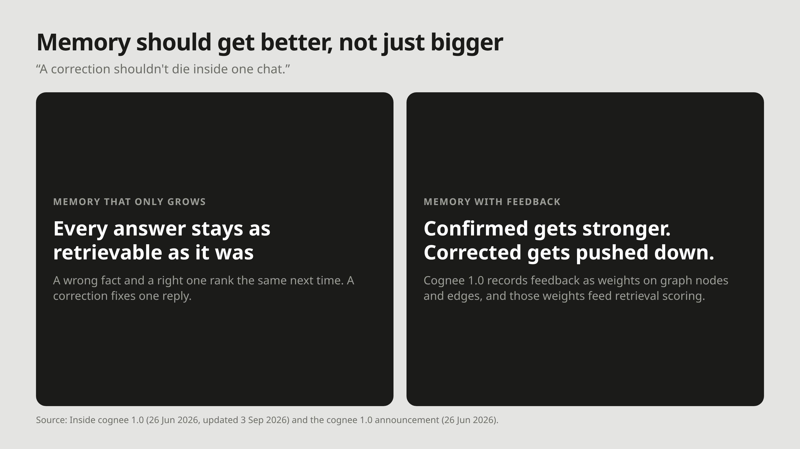

# M14: Memory should get better, not just bigger

**For:** Cognee's LinkedIn and X. **LinkedIn length:** 105 words. **X length:** 215 characters.

## LinkedIn

Most memory only grows. Every new fact is another row, another chunk, another vector, and a wrong answer stays as retrievable as a right one.

Cognee 1.0 closes that loop. Feedback is recorded as weights on graph nodes and edges, and those weights feed retrieval scoring. In the release's words: "Confirmed memories can become stronger. Corrected or misleading ones can be pushed down."

That changes what a correction is worth. Without memory, telling the agent it was wrong fixes one reply. With feedback on memory, it changes what gets retrieved next time.

Or, as the announcement puts it: "A correction shouldn't die inside one chat."

## X

Most agent memory only grows: a wrong answer stays as retrievable as a right one.

Cognee 1.0 records feedback as weights on graph nodes and edges, and retrieval uses them.

A correction shouldn't die inside one chat.

## Source

- [Inside cognee 1.0](https://www.cognee.ai/blog/deep-dives/inside-cognee-1-0), Cognee, 26 Jun 2026 (updated 3 Sep 2026)
- [cognee 1.0 announcement](https://www.cognee.ai/blog/cognee-news/cognee-1-0-announcement), Cognee, 26 Jun 2026
