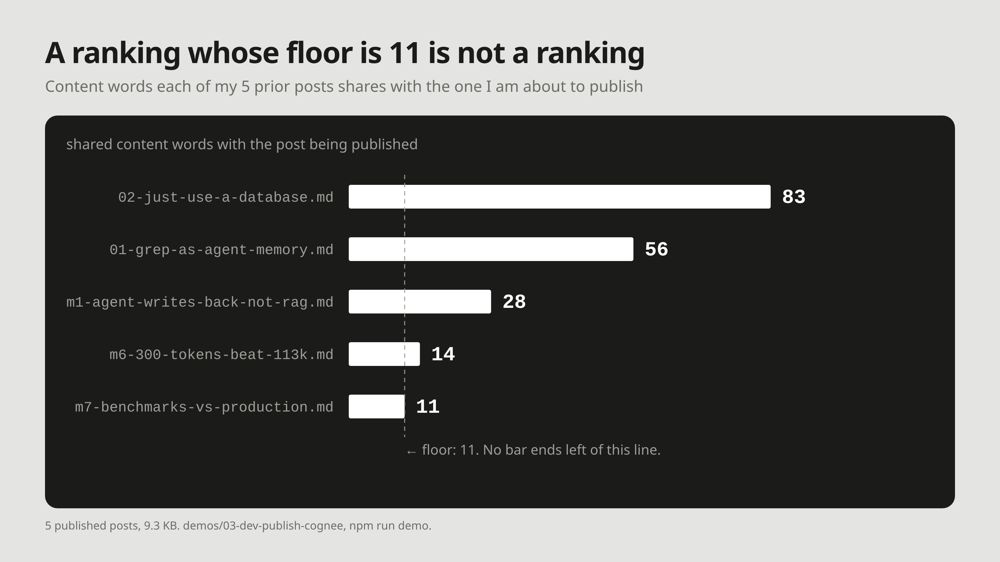

# M9: A ranking whose floor is 11 is not a ranking

**For:** Cognee's LinkedIn and X. **LinkedIn length:** 128 words. **X length:** 192 characters.

## LinkedIn

I expected keyword matching to miss things. On my own archive it hit everything.

The demo checks a new post against the 5 already published, 9.3 KB. Word overlap flagged 5 of 5 as related. Shared content words, post by post: 83, 56, 28, 14, 11.

No zero appeared. A ranking whose floor is 11 is not a ranking: it says every earlier post touched this ground, not which one covered it.

On the support corpus the same method fails the other way: four of eight phrasings of one bug share no content word with the PR that fixed it.

Two corpora, opposite failures. Both point at the same fix: write the link down when the text arrives, rather than infer it from shared words at read time.

## X

Word overlap matched 5 of 5 prior posts in my archive; the lowest shared 11 content words. A ranking whose floor is 11 is not a ranking.

Same method elsewhere: 4 of 8 phrasings share no word.

## Source

- `demos/03-dev-publish-cognee`, `npm run demo` in [yashksaini-coder/cognee-agent-memory-experiments](https://github.com/yashksaini-coder/cognee-agent-memory-experiments), re-run 19 Oct 2026: `word overlap  5/5`, per-post 56 / 83 / 28 / 14 / 11, `(0/5 prior posts share no content word with this one)`. Runs offline, no API key.
- `experiments/db_memory/results.json`, `complaint_vs_fix`, for the 4 of 8 figure. The demo's tokenizer is ported from `experiments/db_memory/db_demo.py`, so the two counts are comparable in method.
- The demo's Cognee rows are skipped without a key. No Cognee run is reported here.
